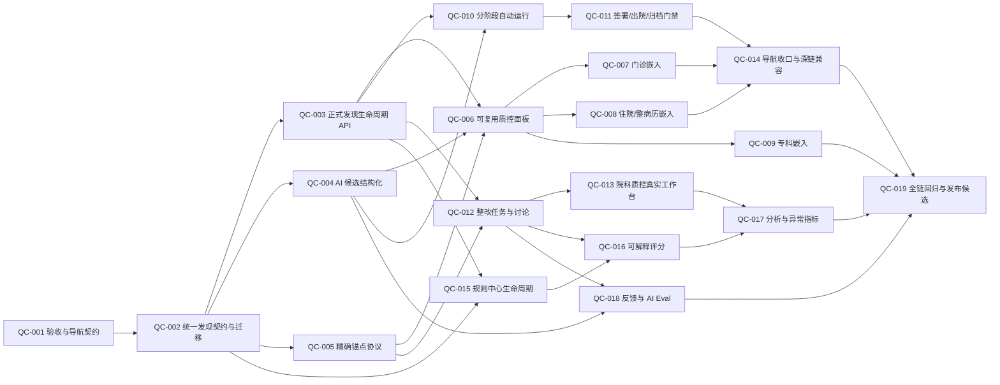

# HaoEMR 嵌入式病历质控优化 —— 研发实施任务清单

> 日期：2026-09-06
> 模式：`BACKLOG + REPLAN`
> 状态：19 个完整任务尚未达到 `VERIFIED`。用户授权后已开始 B0-SAFE 安全切片（QC-005/006/007/008 的部分范围），见下方执行补充；不能把局部实现等同于整项完成。
> 用户决策：病历质控作为横向能力嵌入现有病历、签署、出院、任务和质量工作台；**不新增医生侧质控菜单**。
> 参考材料：佳缘科技《电子病历质控智能一体机》演示视频中的实时/全文质控、精确定位、整改沟通、自动评分与分析机制；只借鉴机制，不复制界面、规则文本或营销指标。

---

## 执行补充：B0-SAFE（2026-09-06）

后续 B1-SAFE 已实现病历工作台行内质控预览、只读章节定位与组合质量筛选；不改变当前接诊患者，不触发质控写入。证据与完整未完成范围见 [B1-SAFE 工作台实施记录](../implementation/2026-09-06-record-qc-workbench-preview.md)。这只是工作台入口子集，不将整次就诊聚合或任何完整任务标为 VERIFIED。

用户已授权开始开发，并明确要求不影响其他正常功能。因此首批从既有治理证据接口的内嵌读模型开始，暂不执行迁移、菜单移除、发现状态写入或新门禁。第 8 节的文档专用调用是原始规划建议，不再代表本轮实施边界。

- **实现中范围**：精确章节定位（QC-005 的字段级子集）、可复用只读面板（QC-006 的确定性子集）、门诊及通用编辑器嵌入（QC-007 部分）、住院单文书问题明细（QC-008 部分）。
- **冻结验收**：只对匹配版本与内容哈希显示结果；修改立即失效；患者/租约/版本切换丢弃晚到响应；字段不在当前编辑区时明确降级；质控读取不能重置草稿；不改变保存、签署、四角色审签及其服务端门禁；不新增菜单。
- **保留原行为**：仍由医生触发已有确定性质控写入，加载页面和保存后仅读取已有证据；不自动运行 AI 或自动改写正文。
- **范围未完成**：工作台聚合、住院整次就诊、十专科接线、字符级锚点、语义候选、整改生命周期、终末门禁和导航迁移仍按原任务推进。本切片不将这些任务标记为完成。
- **验证与风险记录**：[B0-SAFE 实施记录](../implementation/2026-09-06-embedded-record-qc-safe-slice.md)。发布须等待全量阻断项解决并重新验收，不能仅凭局部检查发布。

---

## 执行补充：B2-SAFE（2026-09-06）

本轮已追加：三个编辑器默认关闭的保存后确定性质控、本地书写重复提示、不可变运行明细与当前版本历史、当前就诊只读汇总及工作台历史版本计数修正。额外保护后台刷新期间的未保存正文和并发版本，未新增菜单或放宽既有临床门禁。

这是 QC-002/003/006/007/008/010/019 的部分范围，不是第 6 节完整 B2 批次完成。B0 的「保存后仅仅读取」是当时历史边界；现在仅在用户显式开启本页开关后，成功保存才触发 POST_SAVE。默认关闭仍保持原行为。

局部 API 与前端测试通过，但全量单测、语义门禁及原有写链回归尚存在失败，不标记发布就绪。详细代码、隔离迁移、失败证据、回退和未完范围见 [B2-SAFE 实施记录](../implementation/2026-09-06-record-qc-save-history-summary.md)。19 个完整任务仍未全部 VERIFIED。

---

## 0. 结论与目标体验

本里程碑不建设新的顶层“质控系统”，而是把现有确定性质控、AI 语义复核、专科复核、整改任务和质量统计接成一条真实业务链：

```text
病历书写
  → 输入时快速规则提示
  → 保存后异步语义复核
  → 逐条问题定位与人工裁决
  → 签署/出院/归档前硬门
  → 整改任务与复核关闭
  → 院科质量分析
  → 规则与模型评测改进
```

角色入口遵循以下信息架构：

| 角色/场景 | 入口 | 质控呈现 | 禁止新增 |
|---|---|---|---|
| 门诊、住院、专科医生 | 当前病历编辑器 | 右侧 `RecordQcPanel`、字段标记、保存后状态 | 独立“病历质控”菜单 |
| 审签医生 | 现有签署确认 | 签署前质控摘要、阻断原因、警告处置 | 第二套审签页面 |
| 出院/病案人员 | 现有出院与归档准备 | 终末质控、未闭环项、来源版本 | 独立终末质控菜单 |
| 责任医生 | 现有临床任务中心 | 整改任务、评论、申诉、完成证据 | 独立整改收件箱 |
| 质控员、管理者 | 现有医疗质量中心 → 院科质控 | 跨患者抽查、分派、复核、趋势分析 | 新的顶层质量中心 |

`/record-qc` 可继续作为受保护的上下文深链路和兼容路由，但不再作为医生侧常驻导航入口。

---

## 1. 范围、事实源与现状

### 1.1 需求与验收来源

- `USER-QC-EMBED-01`：质控能力嵌入各病历模块和工作台，不新增菜单。
- `USER-QC-EMBED-02`：支持书写中、保存后、签署前、终末四阶段质控。
- `USER-QC-EMBED-03`：问题必须可解释、可定位、可整改、可复核、可统计。
- `SPEC-SCR-032`：质控人员可发现、分派、复核缺陷，但不得直接改临床原文；医生从缺陷返回对应文书位置整改。
- `DEV-P1/P3/P4`：完成必须体现在用户屏幕；采用 UI→API→DB 纵向切片；优先复用现有后端。
- `DEV-P9/P10/P12`：写操作具备幂等、审计、Outbox；契约优先；AI 候选与临床事实物理分层。

### 1.2 已观察到的可复用能力

- `quality_finding` 已绑定文书不可变版本，具备规则编码、规则版本、严重度、字段路径和 `OPEN/ACKNOWLEDGED/RESOLVED/WAIVED` 状态。
- `document_quality_run` 已绑定内容哈希和来源水位，并且运行记录不可变。
- `DocumentGovernanceService` 已有确定性规则运行、旧问题自动关闭和签署门禁。
- `RECORD_QC` 医助已经支持 `WRITING/PRE_SIGN` 运行阶段，且使用只读授权。
- `clinical_task` 已支持患者、就诊、来源对象、责任人、时限、协作、升级、通知和不可变事件。
- 十个专科复核已能在 FAIL 时创建 `SPECIALTY_QC_REVIEW` 整改任务。
- 医疗质量中心和院科质控已有现成导航位置，但院科质控仍主要基于 `DEPARTMENT_QC_CASE` 通用配置项，尚未与真实 `quality_finding` 完整对账。
- 门诊病历已有右侧质控栏；住院文书已有质控与审签区域；这些是嵌入式组件的首批承载面。

### 1.3 当前关键缺口

1. 医生侧仍存在独立“质控审签”导航，且多个页面各自呈现质控状态。
2. “定位”只跳到通用编辑页，没有文书版本、字段、文本区间的精确锚点。
3. AI 结果是自由结构对象/汇总文本，无法逐条裁决、关联规则、生成整改任务或进入统计。
4. 文书级确定性发现、AI 候选、专科人工复核和院科质控配置尚未形成统一读模型与生命周期。
5. 院科质控分值可以人工录入，当前签署准备度也是前端启发式值，不能作为正式质量评分证据。
6. 质量中心主要展示开放、阻断、逾期和闭环数量，缺少文书类型、规则、阶段、责任人、误报率、复发率和整改耗时等运营维度。

### 1.4 非目标

- 不新增医生侧或顶层质控菜单。
- 不创建第二套临床任务、审计、Outbox、签署或权限系统。
- 不允许 AI 直接生成正式阻断、自动豁免、自动关闭、自动签署或覆盖临床正文。
- 不把确定性硬规则、AI 候选和人工缺陷混成无法解释的单一分数。
- 不把竞品规则文本、省级评价表或宣传中的“准确率/覆盖率/一分钟”等数据复制为产品声明。
- 不在本里程碑采购或绑定专用一体机硬件。
- 不进行微服务拆分、ORM 引入、数据库替换、框架升级或无关 UI 重构。
- 不执行 `push`、生产部署、真实医院数据库迁移或外部模型密钥配置；这些需单独授权。

---

## 2. 目标领域契约

### 2.1 物理分层

保持三类事实物理分层，并通过统一只读 DTO 呈现：

| 类型 | 物理事实源 | 能否阻断 | 进入正式缺陷的条件 |
|---|---|---:|---|
| 确定性规则发现 | 扩展现有 `quality_finding` | 可以，仅规则明确标记为硬门时 | 规则执行直接产生 |
| AI 语义候选 | 新增候选表，关联 `medical_agent_run` | 不可以 | 有权限人员接受后，经领域校验创建正式发现 |
| 人工质控发现 | 正式发现＋人工来源与事件 | 按角色和规则策略决定 | 质控员提交证据并通过权限/版本校验 |

统一读模型建议为 `RecordQcFindingView`，至少包含：

```text
finding_id / candidate_id
origin_type: DETERMINISTIC | AI_CANDIDATE | MANUAL
stage: WRITING | POST_SAVE | PRE_SIGN | TERMINAL | RETROSPECTIVE
dimension: COMPLETENESS | TIMELINESS | CONSISTENCY | RATIONALITY | OTHER
patient_id / encounter_id / document_id / document_version_id
severity / recommended_severity / state
rule_code / rule_version / policy_source
anchor: field_path + start_offset + end_offset + excerpt_hash + schema_version
evidence_references[]
message / rationale / suggestion / confidence
quality_run_id / medical_agent_run_id
assignee / due_at / remediation_task_id
created_at / updated_at / row_version
```

### 2.2 运行与快照

- `document_quality_run` 继续保持不可变。
- 新增运行—发现快照关联，保证某次运行当时包含哪些发现可审计，不能只依赖“当前 finding 状态”。
- 正文、来源、模板或规则版本变化后，旧结论不得自动继承；必须明确显示“基于旧版本”。
- AI 候选绑定模型、Prompt、Agent、工具、来源证据和不可变文书版本。

### 2.3 锚点协议

- URL 只传资源标识和结构化锚点，不携带原文、建议或其他 PHI。
- 锚点至少包含 `documentId/versionId/fieldPath/startOffset/endOffset/excerptHash`。
- 文书版本不一致或哈希校验失败时，不得在新版本上错误高亮；应打开原版本只读视图并提供“查看当前版本”。
- 无法定位的历史发现仍可查看证据，但必须显示“定位已失效”。

### 2.4 正式评分边界

- 评分只使用确定性发现和已经人工确认的正式发现。
- 未裁决 AI 候选不扣分，只单独显示候选数量。
- 分值、等级、维度权重和扣分必须绑定评分策略版本和质控运行快照。
- 硬阻断与分数并行展示；高分不能抵消硬阻断。

---

## 3. 全局完成门禁

1. **嵌入式体验**：医生在当前业务页面内完成查看、定位、整改和复核，不需要通过独立质控菜单寻找患者。
2. **纵向切片**：每个入口同时完成 UI、API、DB、状态、权限和证据链，不接受只有后端表/API 的“完成”。
3. **契约优先**：先改 `contracts/openapi.json`，再运行生成器；禁止手改生成 Java/TypeScript Wire。
4. **状态完整**：覆盖 loading、empty、running、success、partial、error、permission、stale-version、conflict 和 unavailable。
5. **AI 安全**：AI 候选永不直接解除/创建硬门；采纳建议必须进入可编辑草稿并由医生确认。
6. **数据保护**：URL、日志、指标、浏览器审计和 Outbox 不承载病历原文；测试只用合成患者。
7. **并发与幂等**：重复触发不产生重复运行/任务；陈旧版本提交返回明确冲突；任务与发现状态可对账。
8. **性能**：输入时规则不得调用 LLM、不得阻塞键入；保存后语义质控异步执行；实际 P50/P95 目标在 QC-001 基线任务中记录并纳入回归。
9. **视口与可访问性**：验证 1280×800、1440×1000、390×844 和 200% 缩放；侧栏不遮挡主操作，键盘可到达问题和原文字段。
10. **回归**：受影响 Java/API、contracts、Vitest、生产构建、路由语义审计、病历写链、任务闭环、质量中心写链全部通过。
11. **可回滚**：代码按任务 commit 回滚；数据库只做向前修复迁移；新触发器和规则支持 feature flag/配置停用。

批次通用验证命令：

```bash
npm --prefix contracts test
npm --prefix contracts run check
scripts/test-schema.sh
scripts/with-java21.sh ./gradlew test --no-daemon --no-configuration-cache
npm --prefix web test
npm --prefix web run build
npm --prefix web run test:semantic-contract
npm --prefix web run test:ui:record-writes
npm --prefix web run test:ui:clinical-task-automatic-lifecycle
npm --prefix web run test:ui:quality-writes
```

---

## 4. DAG、批次与关键路径

### 4.1 依赖图



关键路径：`QC-001 → QC-002 → QC-003/004/005 → QC-006 → QC-008 → QC-010 → QC-011 → QC-014 → QC-019`。

规则中心、评分、分析可在嵌入式医生体验形成后继续交付，不阻塞第一版右侧质控面板。

### 4.2 DAG 表

```text
task_id,title,requirement_refs,depends_on,parallel_group,risk,owner_skill,status
QC-001,冻结嵌入式质控验收与导航契约,USER-QC-EMBED-01;SPEC-SCR-032,-,B0,HIGH,haonan-s002-prd;haonan-s009-test,PLANNED
QC-002,统一发现读模型与可审计数据迁移,USER-QC-EMBED-03;DEV-P7/P9/P10/P12,QC-001,B1-DATA,HIGH,haonan-s005-1-lld-data;haonan-s008-coder,PLANNED
QC-003,正式发现生命周期与运行快照 API,USER-QC-EMBED-03,QC-002,B1-BACK,HIGH,haonan-s005-2-lld-back;haonan-s008-coder,PLANNED
QC-004,AI 语义质控候选结构化与采纳边界,USER-QC-EMBED-02/03;DEV-P12,QC-002,B1-AGENT,HIGH,haonan-s005-3-lld-agent;haonan-s008-coder,PLANNED
QC-005,病历精确锚点与版本失效协议,USER-QC-EMBED-03;SPEC-SCR-032,QC-002,B1-FRONT,HIGH,haonan-s005-4-lld-front;haonan-s008-coder,PLANNED
QC-006,构建可复用 RecordQcPanel 与状态模型,USER-QC-EMBED-01/03,QC-003;QC-004;QC-005,B2-PANEL,HIGH,haonan-s008-coder,PLANNED
QC-007,门诊病历嵌入式实时与保存后质控,USER-QC-EMBED-01/02,QC-006,B2-SURFACE,MEDIUM,haonan-s008-coder,PLANNED
QC-008,住院文书树与整次就诊质控嵌入,USER-QC-EMBED-01/02,QC-006,B2-SURFACE,HIGH,haonan-s008-coder,PLANNED
QC-009,十个专科质控面板统一接线,USER-QC-EMBED-01/03,QC-006,B2-SURFACE,HIGH,haonan-s008-coder,PLANNED
QC-010,书写/保存/签署/终末四阶段运行编排,USER-QC-EMBED-02,QC-003;QC-004,B3-RUNTIME,HIGH,haonan-s008-coder,PLANNED
QC-011,签署出院归档质控硬门与恢复路径,USER-QC-EMBED-02;DEV-P7,QC-010,B3-GATE,HIGH,haonan-s008-coder;haonan-s009-test,PLANNED
QC-012,质控整改任务评论申诉豁免与复核闭环,USER-QC-EMBED-03;SPEC-SCR-032,QC-003;QC-005,B3-CLOSURE,HIGH,haonan-s008-coder,PLANNED
QC-013,院科质控从配置台账迁移为真实病例工作台,USER-QC-EMBED-01/03,QC-012,B4-QCOPS,HIGH,haonan-s008-coder,PLANNED
QC-014,移除医生侧质控菜单并保持深链兼容,USER-QC-EMBED-01,QC-007;QC-008;QC-011,B4-NAV,MEDIUM,haonan-s008-coder;haonan-s009-test,PLANNED
QC-015,版本化病历质控规则中心与受控运行,USER-QC-EMBED-03,QC-002;QC-003,B4-RULE,HIGH,haonan-s008-coder,PLANNED
QC-016,可解释评分与质量等级快照,USER-QC-EMBED-03,QC-012;QC-015,B5-SCORE,HIGH,haonan-s008-coder,PLANNED
QC-017,院科医生规则阶段多维分析与异常指标,USER-QC-EMBED-03,QC-013;QC-016,B5-ANALYTICS,HIGH,haonan-s008-coder,PLANNED
QC-018,人工反馈到规则与 AI Eval 的治理闭环,USER-QC-EMBED-03;DEV-P12,QC-004;QC-012,B5-EVAL,HIGH,haonan-s009-test;haonan-s008-coder,PLANNED
QC-019,全链 E2E 安全性能与候选发布门禁,ALL,QC-009;QC-014;QC-017;QC-018,B6-RELEASE,HIGH,haonan-s009-test;haonan-s010-safety;haonan-s011-devops,PLANNED
```

---

## 5. 逐任务施工单

### QC-001 冻结嵌入式质控验收与导航契约

- 目标价值：在写代码前固定“质控在哪里出现、谁能做什么、什么算完成”，防止再次新增孤立页面。
- 当前状态：`PLANNED`。
- 硬依赖：无。
- 可并行项：只能并行做只读代码审计；公共契约需单一 owner。
- 输入上下文：`DEVELOPMENT_PRINCIPLES.md`、`RecordGovernancePage.vue`、`ClinicalShell.vue`、`OutpatientRecordPage.vue`、`InpatientDocumentEditorPage.vue`、SCR-032。
- 允许修改：`docs/product/prd/`、`docs/design/ui-delivery/`、`docs/process/testing/route-semantic-contract.json`、本计划状态。
- 禁止项：修改业务代码、改动现有导航以假装完成、承诺未经测量的准确率和性能。
- 实施动作：① 为门诊/住院/专科/签署/出院/任务/质量中心建立入口矩阵；② 冻结角色动作权限；③ 定义四阶段触发语义；④ 定义 loading/empty/running/error/stale/conflict 状态；⑤ 采集合成数据性能基线并记录 P50/P95；⑥ 为“不新增菜单”和深链兼容添加语义断言。
- 接口/Schema/迁移影响：无。
- 测试与验证：语义契约能在恢复 `record-qc` 菜单或移除任一必需嵌入入口时失败。
- 安全与隐私检查：验收截图和 DOM dump 只使用合成患者；URL 不含病历原文。
- 回滚：文档与测试资产独立 commit 回滚。
- DoD：七类场景均有入口、角色、动作、状态、数据源和可观察断言；性能目标有测量依据。
- 输出/交接：`embedded-record-qc-acceptance.md`、更新后的 route semantic contract、QC-002 所需字段清单。

### QC-002 统一发现读模型与可审计数据迁移

- 目标价值：让确定性发现、AI 候选和人工发现可统一展示，同时保留物理安全分层。
- 当前状态：`PLANNED`。
- 硬依赖：QC-001。
- 可并行项：QC-005 的前端锚点交互稿可基于冻结契约并行。
- 输入上下文：`quality_finding`、`document_quality_run`、`medical_agent_run`、专科复核表、生成契约。
- 允许修改：`contracts/openapi.json`、`contracts/generate.mjs`、下一可用 Flyway 迁移、`org.haoemr.clinical`/`org.haoemr.agent` 中最小必要映射、相关 API 测试。
- 禁止项：把 AI 候选直接写入正式 `quality_finding`；删除/重写历史发现；手改生成物；使用自由文本枚举绕过契约。
- 实施动作：① 新增 `RecordQcFindingView`、anchor/evidence DTO；② 扩展正式发现的来源、阶段、维度和人工证据；③ 新增 AI 候选及不可变候选事件；④ 新增 `document_quality_run_finding` 快照关联；⑤ 为现有确定性发现按可证明事实回填来源，未知字段保持 UNKNOWN/nullable；⑥ 增加跨患者工作队列索引；⑦ 生成 Java/TS 契约。
- 接口/Schema/迁移影响：向后兼容新增字段/表；旧 `QualityFindingEvidence` 在迁移窗口保留；数据库迁移只向前。
- 测试与验证：空库迁移、从 V387 基线升级、备份恢复、旧数据读取、AI 与正式发现物理隔离、运行快照不可变测试。
- 安全与隐私检查：anchor 只存偏移与摘要哈希；证据引用不复制大段正文；候选内容遵守现有数据访问范围。
- 回滚：feature flag 停用新读模型；Schema 仅 forward-fix，不删除历史表和列。
- DoD：一个接口可返回三类发现并明确 `origin_type`；历史运行可重建当时发现集合；AI 候选无法通过 SQL/API 冒充硬阻断。
- 输出/交接：迁移、OpenAPI、生成物校验和、数据字典、升级对账报告。

### QC-003 正式发现生命周期与运行快照 API

- 目标价值：为确认、分派、解决、豁免、重开和复核提供唯一领域入口。
- 当前状态：`PLANNED`。
- 硬依赖：QC-002。
- 可并行项：QC-004。
- 输入上下文：`DocumentGovernanceService`、`ClinicalTaskService`、幂等/审计/Outbox 模式。
- 允许修改：`org.haoemr.clinical`、`org.haoemr.quality`、相关 controllers、OpenAPI、Java API tests。
- 禁止项：页面直接更新 finding 表；删除事件；跨版本继承豁免；质控人员直接修改临床原文。
- 实施动作：① 提供按文书/就诊/患者读取发现接口；② 实现 ACKNOWLEDGE/RESOLVE/WAIVE/REOPEN 状态机；③ 每个写命令校验角色、版本和 row_version；④ 写入不可变 finding event、审计和 Outbox；⑤ 质控重新运行时记录新增/持续/消失而非静默覆盖；⑥ 提供运行历史和差异接口。
- 接口/Schema/迁移影响：新增命令与查询端点；现有文书治理 snapshot 保持兼容。
- 测试与验证：状态转移、非法转移、并发冲突、重复幂等键、跨租户/跨患者拒绝、旧版本豁免失效、Outbox 对账。
- 安全与隐私检查：WAIVE 必填有权限角色、原因和有效范围；BLOCKING 豁免需要更高权限和二次确认策略。
- 回滚：停用新命令端点并恢复旧只读路径；保留已产生事件。
- DoD：所有正式状态变化只能通过领域命令完成，且 API、finding event、audit、Outbox 四者可对账。
- 输出/交接：状态机说明、API 示例、失败码、测试证据。

### QC-004 AI 语义质控候选结构化与采纳边界

- 目标价值：把当前自由结构 AI 汇总变成可逐条定位和裁决的安全候选。
- 当前状态：`PLANNED`。
- 硬依赖：QC-002。
- 可并行项：QC-003、QC-005。
- 输入上下文：`MedicalAgentHarnessService`、`medical-agent-run-presenter.ts`、RECORD_QC 主/子 Agent、模型输出守卫和预算。
- 允许修改：Agent 输出 JSON Schema、Prompt release、output guard、`org.haoemr.agent`、OpenAPI、evals 和合成 provider。
- 禁止项：AI 返回直接可执行 SQL/HTML；候选直接改变签署结论；自动采纳或自动写正文；省略证据来源。
- 实施动作：① 定义 `RecordQcCandidateSetV1`；② 每条候选输出维度、问题、理由、建议、推荐严重度、置信度、anchor、证据引用；③ output guard 拒绝缺来源/越权/错误目标版本；④ 将合格候选持久化并关联 run/model/prompt/tool 版本；⑤ 实现接受候选命令，由领域服务重新校验后创建正式发现；⑥ 增加拒绝、误报和不确定裁决。
- 接口/Schema/迁移影响：Agent `contribution` 从无约束对象增加版本化业务 schema；保留旧 run 的兼容 presenter。
- 测试与验证：有效/缺字段/伪造阻断/越权来源/提示注入/过长输出/部分失败/重复候选去重 eval；真实模型不可用时失败关闭。
- 安全与隐私检查：模型只获得授权范围；输出不得泄漏其他患者；Prompt/日志不记录完整病历；AI 候选 UI 明示“待人工复核”。
- 回滚：切回旧汇总 presenter；停用候选采纳 feature flag；保留 run 证据。
- DoD：RECORD_QC 运行能产生逐条候选；任何候选在人工接受前都不计正式缺陷、不扣分、不阻断。
- 输出/交接：schema、Prompt release、eval 集、候选 API 示例、模型边界报告。

### QC-005 病历精确锚点与版本失效协议

- 目标价值：医生点击问题即可回到正确文书、正确版本、正确字段和具体文本位置。
- 当前状态：`PLANNED`。
- 硬依赖：QC-002。
- 可并行项：QC-003、QC-004。
- 输入上下文：`RecordEditorPage.vue`、`OutpatientRecordPage.vue`、`InpatientDocumentEditorPage.vue`、文书版本/差异页。
- 允许修改：前端 route query codec、编辑器 section 注册表、锚点 composable、后端 anchor 校验、前端单元测试。
- 禁止项：在 URL 传原文或患者身份明文；对错误版本强行高亮；通过 DOM 模糊文本搜索定位临床字段。
- 实施动作：① 冻结 anchor codec；② 编辑器为可质控字段注册稳定 fieldPath；③ 解析深链后滚动、聚焦、高亮并提供返回缺陷；④ 校验 versionId/excerptHash；⑤ stale 时打开原版本只读并解释原因；⑥ 移动端以底部抽屉替代遮挡式双栏。
- 接口/Schema/迁移影响：route query 向后兼容；历史只有 field_path 的发现降级为字段级定位。
- 测试与验证：当前版本、旧版本、字段删除、偏移变化、未知字段、移动端、键盘焦点和浏览器后退测试。
- 安全与隐私检查：浏览器历史、日志和 analytics 只能出现 ID/哈希，不出现 excerpt。
- 回滚：停用精确区间定位，恢复字段级定位；深链参数继续可忽略。
- DoD：合成病例中每种发现都能定位或明确报告失效，绝不高亮错误正文。
- 输出/交接：anchor 协议、字段注册表、兼容矩阵、页面测试证据。

### QC-006 构建可复用 RecordQcPanel 与状态模型

- 目标价值：用一个可复用组件替代各病历页面自行实现质控列表。
- 当前状态：`PLANNED`。
- 硬依赖：QC-003、QC-004、QC-005。
- 可并行项：无；它是三类业务页面接线基础。
- 输入上下文：现有门诊 right rail、住院质控区、`RecordGovernancePage.vue`、原型 CSS 与计算样式。
- 允许修改：`web/src/vue/components/RecordQcPanel.vue`（新增）、相关 composables/API、共享样式映射、Vitest。
- 禁止项：复制三套组件；引入第二套 CSS 体系；把硬规则和 AI 候选只用颜色区分；在面板内直接修改已签正文。
- 实施动作：① 支持 CURRENT_DOCUMENT/ENCOUNTER/PATIENT 三种 scope；② 分开展示硬规则、机构规则、AI 候选、人工发现；③ 支持筛选、运行状态、定位、接受/误报/豁免/转任务；④ 展示规则版本和证据；⑤ 处理 running/partial/stale/conflict；⑥ 提供 compact、rail、drawer 三种布局；⑦ 提供可访问名称和键盘顺序。
- 接口/Schema/迁移影响：无新增 DB；使用 QC-003/004 DTO。
- 测试与验证：组件状态矩阵测试；1280×800 与 390×844；长文本、50+发现虚拟/分页加载；无 horizontal overflow。
- 安全与隐私检查：默认折叠敏感证据；精神心理等 RESTRICTED 数据继续遵守上下文授权。
- 回滚：各页面通过 feature flag 切回旧只读列表。
- DoD：同一组件可在门诊、住院、专科、签署页渲染，三类发现来源语义清晰且所有状态可观察。
- 输出/交接：组件 API、Story/状态夹具、可访问性和视口证据。

### QC-007 门诊病历嵌入式实时与保存后质控

- 目标价值：门诊医生不离开当前病历即可发现和处理问题。
- 当前状态：`PLANNED`。
- 硬依赖：QC-006。
- 可并行项：QC-008、QC-009。
- 输入上下文：`OutpatientRecordPage.vue`、`RecordEditorPage.vue`、自动暂存、当前 right rail。
- 允许修改：门诊病历页面、编辑器、质控 composable、门诊浏览器验证脚本。
- 禁止项：每次击键调用 AI；实时规则失败阻断文本输入；保存失败时仍显示“已质控”。
- 实施动作：① 用 `RecordQcPanel` 替换现有简单 right rail；② 输入时只运行本地/服务端快速确定性规则；③ 保存成功后按内容哈希发起异步 POST_SAVE；④ 展示最后检查时间和所依据版本；⑤ 定位后聚焦字段；⑥ 修改并保存后自动重评受影响发现；⑦ 保留明确的手动“完整复核”。
- 接口/Schema/迁移影响：复用现有保存 API；新增幂等运行请求时必须绑定内容哈希。
- 测试与验证：新建→输入→提示→保存→AI running→候选→定位→修改→重评；网络失败、并发保存、患者切换和草稿恢复。
- 安全与隐私检查：切换患者时清空旧患者 finding cache；不把正文写入浏览器 telemetry。
- 回滚：feature flag 恢复旧 right rail 和手动运行按钮。
- DoD：完整门诊闭环在单一页面完成；无独立质控导航依赖；重复保存不产生重复运行。
- 输出/交接：门诊 E2E 脚本、性能记录、截图/DOM 状态证据。

### QC-008 住院文书树与整次就诊质控嵌入

- 目标价值：在住院病历目录中看到每份文书的质量状态，并可执行整次就诊跨文书检查。
- 当前状态：`PLANNED`。
- 硬依赖：QC-006。
- 可并行项：QC-007、QC-009。
- 输入上下文：住院总览、文书目录、`InpatientDocumentEditorPage.vue`、四级审签、出院闭环。
- 允许修改：住院文书目录/编辑器/总览、后端 encounter-scope 查询、住院浏览器脚本。
- 禁止项：一次加载所有文书全文到浏览器；把跨文书 AI 候选变成直接阻断；使用聚合分数隐藏具体缺陷。
- 实施动作：① 文书树显示阻断/警告/AI 候选徽标；② 当前文书右侧嵌入 panel；③ 增加“整次就诊复核”并异步显示进度；④ 跨文书一致性候选携带双方文书证据；⑤ 质控时间轴显示运行、整改和复核；⑥ 点击树徽标进入正确文书锚点；⑦ 大病历采用分页/按需加载。
- 接口/Schema/迁移影响：新增 encounter-scope 聚合查询和批次运行状态；不得返回未授权文书。
- 测试与验证：多文书、多版本、跨文书矛盾、部分失败、50+文书性能、四级审签角色、转区后权限变化。
- 安全与隐私检查：文书目录只暴露最小状态；跨科/跨区数据按上下文 lease 过滤。
- 回滚：隐藏整病历入口并保留当前文书面板；批次运行记录保持可审计。
- DoD：医生可从住院文书树发现问题、进入原文、修改和复核；整次就诊运行不阻塞编辑。
- 输出/交接：住院 E2E、分页性能、角色/权限测试证据。

### QC-009 十个专科质控面板统一接线

- 目标价值：保留专科硬门和复核语义，同时统一发现呈现与整改体验。
- 当前状态：`PLANNED`。
- 硬依赖：QC-006。
- 可并行项：QC-007、QC-008。
- 输入上下文：`SpecialtyQcReviewPanel.vue`、十个专科 QcReviewService/API tests、能力包。
- 允许修改：共享专科 panel、专科 API adapter、能力包映射、现有专科测试和浏览器脚本。
- 禁止项：删除专科数据库硬门；把十种业务对象强行改成一种表；复制十份前端质控逻辑。
- 实施动作：① 建立 specialty record→统一 read model adapter；② FAIL 人工复核生成正式发现并关联原专科复核；③ 复用统一定位/任务/复核动作；④ 保留专科原始证据和业务名称；⑤ 按能力包决定可用维度与规则；⑥ 合并十个页面的重复 UI 但不改变领域约束。
- 接口/Schema/迁移影响：向现有专科复核响应增加 finding/task 引用；保持旧字段兼容。
- 测试与验证：十个专科 PASS/FAIL、缺陷必填、自动任务、定位、解决、权限和能力包关闭测试。
- 安全与隐私检查：精神心理限制级数据不得出现在通用质量统计明细；只输出脱敏计数。
- 回滚：adapter 可停用，原 `SpecialtyQcReviewPanel` 和任务创建继续工作。
- DoD：十个专科使用统一面板和状态语义，原有硬门与测试全部保持通过。
- 输出/交接：专科映射表、十域回归报告、兼容性说明。

### QC-010 书写/保存/签署/终末四阶段运行编排

- 目标价值：在正确时机运行正确成本和风险级别的质控，不打断临床书写。
- 当前状态：`PLANNED`。
- 硬依赖：QC-003、QC-004。
- 可并行项：QC-012。
- 输入上下文：文书保存事件、Agent worker/预算、签署与归档用例、任务调度和 Outbox。
- 允许修改：文书生命周期事件处理、质控 orchestrator、Agent 运行策略、配置和可观测指标。
- 禁止项：输入阶段调用 LLM；同步等待语义模型后才允许保存；无预算无限重试；同一哈希重复运行。
- 实施动作：① 定义 FAST/POST_SAVE/PRE_SIGN/TERMINAL 策略；② 以 documentVersion/contentHash/ruleSet/stage 构造幂等键；③ POST_SAVE 经 Outbox 异步排队；④ PRE_SIGN/TERMINAL 聚合硬规则和可见候选；⑤ 支持取消过期运行和 last-write-wins；⑥ 记录排队、运行、失败、降级和耗时指标；⑦ 提供机构级开关与预算。
- 接口/Schema/迁移影响：新增运行请求/状态字段或事件；兼容现有手动 `runQualityChecks`。
- 测试与验证：重复保存、快速连续版本、worker 重启、模型不可用、预算耗尽、部分 child agent 失败、Outbox 重放。
- 安全与隐私检查：运行参数只含资源 ID；模型调用继续受 lease、tool allowlist 和预算控制。
- 回滚：关闭自动触发，恢复手动质控；不删除已产生运行记录。
- DoD：四阶段触发可通过事件证据区分；保存不等待模型；同一目标不会重复创建有效运行。
- 输出/交接：运行状态机、幂等键规范、指标与失败恢复报告。

### QC-011 签署、出院、归档质控硬门与恢复路径

- 目标价值：关键终态只由确定性规则和已确认事实阻断，同时为用户提供明确恢复动作。
- 当前状态：`PLANNED`。
- 硬依赖：QC-010。
- 可并行项：QC-013 可先开发只读队列。
- 输入上下文：签署服务、住院出院闭环、`ArchiveService`、四级审签和来源水位。
- 允许修改：签署/出院/归档前置校验、对应 UI 摘要、错误码、恢复动作和 API tests。
- 禁止项：AI 候选直接阻断；高分抵消硬门；提供“强制通过”；修改已签版本。
- 实施动作：① PRE_SIGN 绑定当前内容哈希和来源水位；② TERMINAL 聚合未签、时限、首页/编码、结果、整改等确定性事实；③ 阻断响应返回逐项 finding 和目标 route；④ 页面内定位并修复后可重跑；⑤ stale run 明确失效；⑥ 合法豁免走 QC-003 权限与二次确认；⑦ 终态写入不可变证据。
- 接口/Schema/迁移影响：现有签署/归档错误响应增加结构化 blockers；保持旧 error code 可识别。
- 测试与验证：无运行、通过、警告、阻断、AI-only、旧版本、来源变化、合法/非法豁免、并发签署、紧急离院。
- 安全与隐私检查：错误响应不返回无权限正文；紧急流程不伪装为质控通过。
- 回滚：关闭新聚合门禁，恢复现有确定性质控门；已写终态证据保留。
- DoD：每个阻断均能说明事实、规则、版本和恢复路径；AI-only 场景不阻断；终态不可绕过。
- 输出/交接：门禁矩阵、错误码、E2E 与审计证据。

### QC-012 质控整改任务、评论、申诉、豁免与复核闭环

- 目标价值：让质控员和责任医生围绕同一条发现协作，而不是另建消息系统。
- 当前状态：`PLANNED`。
- 硬依赖：QC-003、QC-005。
- 可并行项：QC-010。
- 输入上下文：`clinical_task`、task event/delegation/team queue/notification、专科整改任务。
- 允许修改：任务 source type、finding event、任务服务/UI、通知、OpenAPI、任务 E2E。
- 禁止项：另建整改待办系统；在评论中复制完整病历；完成任务即自动判定缺陷已解决；删除申诉/豁免历史。
- 实施动作：① 增加 `DOCUMENT_QC_FINDING` 来源或等价受控类型；② 正式发现可幂等生成一条整改任务；③ `source_route` 使用 QC-005 深链；④ 支持评论、补充证据、申诉、退回、转派、升级；⑤ 医生提交整改后进入 `PENDING_REVIEW`，由规则复跑或质控员复核；⑥ task completion 与 finding resolution 分开并对账；⑦ SLA 通知复用现有调度。
- 接口/Schema/迁移影响：扩展 task/finding event 枚举，新增必要关联；旧专科任务继续兼容。
- 测试与验证：创建、重复创建、领取、转派、评论、申诉、超期、复核通过/退回、来源作废、通知恢复、团队队列权限。
- 安全与隐私检查：评论长度和内容审计；限制级数据不进入普通通知；质控员无权修改正文。
- 回滚：停用自动建任务；现有任务保留并可从任务中心完成。
- DoD：发现、任务、评论、整改版本和复核结论形成可追踪闭环；任何一方不能单方面抹除历史。
- 输出/交接：任务映射、状态对账表、E2E 报告。

### QC-013 院科质控从配置台账迁移为真实病例工作台

- 目标价值：让现有“医疗质量中心 → 院科质控”展示真实发现和整改，而不是人工维护的配置对象。
- 当前状态：`PLANNED`。
- 硬依赖：QC-012。
- 可并行项：QC-015。
- 输入上下文：`DepartmentQcPage.vue`、`QualityOperationsPanel.vue`、`DEPARTMENT_QC_CASE`、quality governance depth pages。
- 允许修改：`org.haoemr.quality` 查询/抽样服务、院科质控页面、真实 case 表/关联、quality-center tests。
- 禁止项：新增顶层菜单；在质量中心直接改临床正文；把无患者关联的旧配置伪装成真实病例；手工编辑正式评分。
- 实施动作：① 建立真实抽样任务和 case→finding 关联；② 队列支持周期、机构、科室、病区、文书类型、严重度、来源、责任人、逾期筛选；③ 三栏/响应式展示病例队列、只读原文证据、动作；④ 从 case 创建/分派整改任务；⑤ 复核关闭后回写真实生命周期；⑥ 旧 `DEPARTMENT_QC_CASE` 无可验证临床引用的记录保留为只读历史/配置，不回填患者；⑦ 导出只包含授权和最小必要字段。
- 接口/Schema/迁移影响：新增真实 case API；通用配置 API 不再作为运行时事实源，但不立即删除。
- 测试与验证：抽样→发现→分派→跨域整改→复核关闭；筛选、分页、越权科室、旧数据兼容、导出脱敏、并发复核。
- 安全与隐私检查：跨患者列表默认最小身份；查看正文需单独上下文授权并审计。
- 回滚：页面 feature flag 切回旧台账只读；真实 case 数据保留。
- DoD：院科质控开放/阻断/逾期/闭环数均来自真实 case/finding/task，可逐项下钻对账。
- 输出/交接：迁移说明、旧数据处置报告、院科质控 E2E。

### QC-014 移除医生侧质控菜单并保持深链兼容

- 目标价值：落实“质控是能力，不是新菜单”，同时不破坏历史链接和签署流程。
- 当前状态：`PLANNED`。
- 硬依赖：QC-007、QC-008、QC-011。
- 可并行项：QC-016、QC-018。
- 输入上下文：`ClinicalShell.vue`、router、route registry、metric links、顶部/侧栏浏览器测试。
- 允许修改：导航注册、route metadata、`/record-qc` wrapper、语义契约和链接。
- 禁止项：删除 `/record-qc` 导致旧任务链接 404；移除“医疗质量中心 → 院科质控”；把签署入口一起隐藏。
- 实施动作：① 从医生病历子菜单移除“质控审签”；② 保留 `/record-qc` 上下文 wrapper；③ 无上下文访问时返回当前病历或明确空态；④ 全仓链接改为页面内 panel/action；⑤ 旧链接携带 anchor 时继续有效；⑥ 更新活动菜单映射和 route tests；⑦ 验证患者切换后无旧上下文残留。
- 接口/Schema/迁移影响：无 DB；路由为兼容性变更。
- 测试与验证：菜单不存在、门诊/住院/签署入口仍存在、旧 bookmark、任务 source_route、浏览器后退、无权限和未知 ID。
- 安全与隐私检查：深链访问重新校验 lease，不因隐藏菜单而放宽权限。
- 回滚：恢复导航项；深链 wrapper 始终保留。
- DoD：医生完成质控全链无需独立菜单；全量合法旧链接不 404；质量管理员入口保持不变。
- 输出/交接：导航差异、兼容路由矩阵、194 路由语义报告。

### QC-015 版本化病历质控规则中心与受控运行

- 目标价值：把硬编码规则升级为可追溯、可测试、可灰度的国家/省级/医院规则资产。
- 当前状态：`PLANNED`。
- 硬依赖：QC-002、QC-003。
- 可并行项：QC-013、QC-014。
- 输入上下文：`DocumentGovernanceService` 中现有规则、配置生命周期、数据质量规则服务、知识中心质控规则资料。
- 允许修改：病历质控规则 registry/version/service、配置发布能力、现有规则 adapter、医疗质量中心或现有规则配置入口。
- 禁止项：新增顶层规则菜单；允许用户上传任意可执行代码；发布无测试用例规则；覆盖历史版本；把外部文件直接视为权威现行规则。
- 实施动作：① 建立规则编码、辖区、来源、适用机构/科室/文书、维度、严重度、扣分、有效期；② 将现有 Java validator 注册为受控 evaluator；③ 支持草稿、验证、灰度、ACTIVE、RETIRED、回滚；④ 发布前运行合成病例和影响模拟；⑤ 一次运行冻结规则集版本；⑥ 提供差异和来源引用；⑦ 规则入口放入现有业务配置/知识中心/质量中心上下文中。
- 接口/Schema/迁移影响：新增规则/版本/发布 schema；现有 RULE_VERSION 映射到首个系统版本且不改历史 run。
- 测试与验证：重码、无来源、过期、范围冲突、灰度、回滚、旧版本重放、规则集哈希、合成病例命中/不命中。
- 安全与隐私检查：规则不能执行任意脚本或外联；来源文件访问受权限和版本控制。
- 回滚：回退 ACTIVE 规则集到上一已验证版本；代码 evaluator 可独立回滚；历史版本不可删除。
- DoD：每条运行结果可追溯到规则集、规则版本和来源；规则变更可模拟、灰度和回退。
- 输出/交接：规则数据字典、现有规则迁移表、发布/回滚报告。

### QC-016 可解释评分与质量等级快照

- 目标价值：提供可复核的质量评分，而不是人工输入或前端启发式百分比。
- 当前状态：`PLANNED`。
- 硬依赖：QC-012、QC-015。
- 可并行项：QC-014、QC-018。
- 输入上下文：当前 `readinessPercent`、院科 `score` 表单、规则权重、正式发现生命周期。
- 允许修改：评分策略/快照、OpenAPI、签署/院科 UI、指标测试。
- 禁止项：未确认 AI 候选扣分；手工直接修改快照分值；高分覆盖硬门；不显示扣分明细。
- 实施动作：① 定义版本化评分策略和等级阈值；② 按正式发现计算维度分与扣分项；③ 运行时产生不可变 score snapshot；④ 单独显示硬阻断、AI 候选和行政评分；⑤ 移除/降级前端启发式“签署准备度”；⑥ 院科台账取消手工正式评分输入；⑦ 支持历史策略重现而非重写。
- 接口/Schema/迁移影响：新增 score policy/snapshot；旧手工 score 标记为 legacy，不回填正式快照。
- 测试与验证：相同规则集确定性、边界阈值、硬阻断高分、AI-only、豁免、规则版本变化、历史重现。
- 安全与隐私检查：评分输出不得被描述为诊疗正确性或模型准确率；管理使用范围有说明。
- 回滚：停用正式评分展示并继续显示分层发现；历史快照保留。
- DoD：每一分变化都能追溯到确认发现和规则版本；不存在可直接编辑的正式分值。
- 输出/交接：评分策略、样例算分、历史兼容和验证报告。

### QC-017 院、科、医生、规则、阶段多维分析与异常指标

- 目标价值：把真实质控闭环数据转化为可行动的质量改进证据。
- 当前状态：`PLANNED`。
- 硬依赖：QC-013、QC-016。
- 可并行项：QC-018。
- 输入上下文：`QualityCenterPage.vue`、metric snapshot、真实 case/finding/task/score 快照。
- 允许修改：事实聚合查询/快照、质量中心现有页面、CSV 导出、指标测试。
- 禁止项：新增分析菜单；直接按小样本医生排名；在指标维度保存患者标识或正文；用演示数字补空态。
- 实施动作：① 建立从 run/finding/task/score 派生的质量事实；② 支持院区、科室、病区、医生、文书类型、规则、阶段、来源和时间维度；③ 指标包括通过率、阻断率、误报率、复发率、整改时长、逾期率和覆盖度；④ 异常检测显示口径、样本量和基线；⑤ 可从聚合下钻到授权 case；⑥ 展示数据截止和规则集版本；⑦ 前后对比不得暗示未经验证的因果关系。
- 接口/Schema/迁移影响：新增/扩展 metric type 和维度 schema；聚合数据与运行事实可对账。
- 测试与验证：聚合对账、零样本、小样本抑制、时区、跨月、规则版本、权限下钻、导出脱敏和性能。
- 安全与隐私检查：医生维度实施最小样本阈值和角色控制；导出审计；不暴露精神心理限制级明细。
- 回滚：关闭新维度，质量中心恢复基础计数；快照保留。
- DoD：看板每个数字都能追溯到真实事实源、口径和数据截止；异常项可下钻为整改行动。
- 输出/交接：指标字典、SQL/血缘、对账和权限报告。

### QC-018 人工反馈到规则与 AI Eval 的治理闭环

- 目标价值：把接受、误报、申诉、豁免和复核结果用于降低重复误报，而不是只做 UI 按钮。
- 当前状态：`PLANNED`。
- 硬依赖：QC-004、QC-012。
- 可并行项：QC-016、QC-017。
- 输入上下文：AI candidate events、model evaluation、Prompt release、现有 evals 与安全载荷。
- 允许修改：反馈事件、脱敏样本导出、eval 生成/检查脚本、模型发布门禁、质量/AI 管理现有入口。
- 禁止项：未经授权用真实病历训练；把豁免等同于误报；自动发布新模型/Prompt；保留可逆推出患者的自由文本样本。
- 实施动作：① 标准化 ACCEPTED/FALSE_POSITIVE/INSUFFICIENT_EVIDENCE/WAIVED 等裁决；② 区分规则错误、模型错误、上下文不足和合法例外；③ 只从授权、脱敏、人工确认样本生成 eval；④ 按规则/模型/Prompt 版本计算精确率代理和召回测试；⑤ 发布门禁比较回归与安全指标；⑥ 失败创建治理待办而非自动改规则；⑦ 保存 provenance 和撤回链。
- 接口/Schema/迁移影响：新增反馈汇总/导出契约；不改变临床原文。
- 测试与验证：裁决一致性、脱敏、重复样本、患者撤回、Prompt 注入、兄弟规则混淆、回归阈值和发布拒绝。
- 安全与隐私检查：真实数据默认不可导出；训练/外传另需审批；eval 制品不得含直接标识和长原文。
- 回滚：停止新样本进入 eval；已审计裁决保留；模型/Prompt 回退上一已发布版本。
- DoD：每次模型/规则发布有版本化 eval 证据；误报反馈能生成可追踪治理任务但不自动改变临床行为。
- 输出/交接：反馈字典、脱敏说明、eval 集、发布门禁报告。

### QC-019 全链 E2E、安全、性能与候选发布门禁

- 目标价值：证明嵌入式质控在真实用户路径、权限、失败和恢复场景下可用。
- 当前状态：`PLANNED`。
- 硬依赖：QC-009、QC-014、QC-017、QC-018，以及所有关键路径任务。
- 可并行项：安全测试、性能测试和浏览器测试可分组执行，但共享数据库夹具需隔离。
- 输入上下文：全部前序输出、`scripts/verify.sh`、病历写链、任务闭环、质量中心写链、路由审计。
- 允许修改：测试、夹具、性能门禁、发布文档；只修复本里程碑暴露的确定性缺陷。
- 禁止项：为过测试降低医疗硬门；使用 sleep 掩盖竞态；把本机合成验证写成生产就绪；自动 push/部署。
- 实施动作：① 新增门诊、住院、专科、签署、终末、整改、质控员、分析八条 E2E；② 覆盖断网、模型不可用、worker 重启、并发版本、权限撤销和 stale anchor；③ 跑 390/1280/1440 视口；④ 执行 PHI/日志/URL/导出扫描；⑤ 执行输入快速规则和大病历聚合性能测试；⑥ 完整运行统一门禁；⑦ 冻结候选 commit 和迁移清单，生产发布另立授权任务。
- 接口/Schema/迁移影响：不得新增未经前序设计的临时接口；发现契约问题回到对应任务修复。
- 测试与验证：批次通用命令＋新增 `test:ui:embedded-record-qc`；`scripts/verify.sh`；迁移/备份恢复；安全红队。
- 安全与隐私检查：S010 检查通过；无真实 PHI、Token、私钥、外部端点秘密；RBAC/ABAC 越权为 0。
- 回滚：按候选 commit 回滚应用；数据库只按 forward-fix；自动运行、评分和分析各自有 feature flag。
- DoD：八条 E2E 通过；P0/P1 确定性缺陷为 0；性能达到 QC-001 冻结目标；统一门禁全绿；未新增医生侧菜单。
- 输出/交接：候选 commit、迁移顺序、测试/安全/性能报告、未授权发布事项清单。

---

## 6. 推荐执行批次

| 批次 | 任务 | 可交付用户价值 | 发布建议 |
|---|---|---|---|
| B0 契约冻结 | QC-001 | 明确不新增菜单、角色和验收边界 | 不发布业务功能 |
| B1 数据与接口 | QC-002–005 | 三类发现可统一读取、精确定位、AI 安全分层 | feature flag 关闭 |
| B2 医生侧嵌入 | QC-006–009 | 门诊/住院/专科页面内查看与处理质控 | 可做内部试用候选 |
| B3 自动运行与闭环 | QC-010–012 | 四阶段自动质控、终态门禁、整改任务 | 需完整临床回归 |
| B4 信息架构与管理端 | QC-013–015 | 真实院科工作台、导航收口、规则治理 | 可做院内试点候选 |
| B5 评分分析评测 | QC-016–018 | 可解释评分、真实分析、持续改进 | 需治理审批 |
| B6 候选发布 | QC-019 | 全链证据与可回滚候选版本 | push/部署另行授权 |

首个可见里程碑是 B2：医生在门诊和住院病历内看到统一质控面板，但自动 AI、终态门禁和正式评分仍按 feature flag 分批开启。

---

## 7. 风险与授权清单

| 风险/事项 | 级别 | 控制措施 | 是否需额外授权 |
|---|---:|---|---|
| AI 候选误报影响签署 | 高 | 物理分层；候选不阻断、不扣分；人工接受后再入正式发现 | 产品内无需；真实模型上线需审批 |
| 历史 finding 无运行关联 | 高 | 不伪造；标记 legacy/unknown；从新运行开始完整快照 | 无 |
| 锚点指向错误版本 | 高 | versionId＋excerptHash 校验；失败转原版本只读 | 无 |
| 院科旧配置缺患者引用 | 高 | 保留只读历史，不回填虚假患者/文书 | 无 |
| 实时规则影响输入性能 | 中 | 输入阶段禁止 LLM；debounce/last-write-wins；性能门禁 | 无 |
| 医生排名与小样本偏差 | 高 | 最小样本阈值、口径展示、权限限制、禁用因果表述 | 指标政策需院方确认 |
| 真实病历进入 AI/eval | 极高 | 默认禁止外传与训练；只用合成/授权脱敏样本 | 必须单独授权与合规评估 |
| 数据库迁移 | 高 | 空库＋升级＋备份恢复；只向前修复 | 生产执行必须另行授权 |
| push/部署/规则发布 | 高 | 与开发完成分离；冻结候选 commit 后单独审批 | 必须另行授权 |

---

## 8. 给 haonan-s008-coder 的首个推荐调用

建议先执行 `QC-001`，不要直接从数据库迁移或删除菜单开始：

```text
使用 haonan-s008-coder 执行 QC-001。
目标：冻结 HaoEMR 嵌入式病历质控的入口、角色、四阶段运行和状态验收契约，明确医生侧不新增/不保留常驻质控菜单，但 /record-qc 作为受保护深链兼容路由继续存在。
必读：
- DEVELOPMENT_PRINCIPLES.md
- docs/process/planning/2026-09-06-embedded-record-qc-development-backlog.md
- docs/design/2026-08-13-haoemr-v1.0-prototype-spec.md 的 SCR-032
- web/src/vue/components/ClinicalShell.vue
- web/src/vue/views/RecordGovernancePage.vue
- web/src/vue/views/OutpatientRecordPage.vue
- web/src/vue/views/InpatientDocumentEditorPage.vue
只允许修改产品/验收文档和语义测试资产，不改业务代码。所有结果保持 PLANNED/OBSERVED，未运行的实现任务不得标 VERIFIED。
```

QC-001 完成并评审后，再把其字段清单、角色矩阵、状态矩阵和性能基线作为 QC-002 的最小上下文包。
