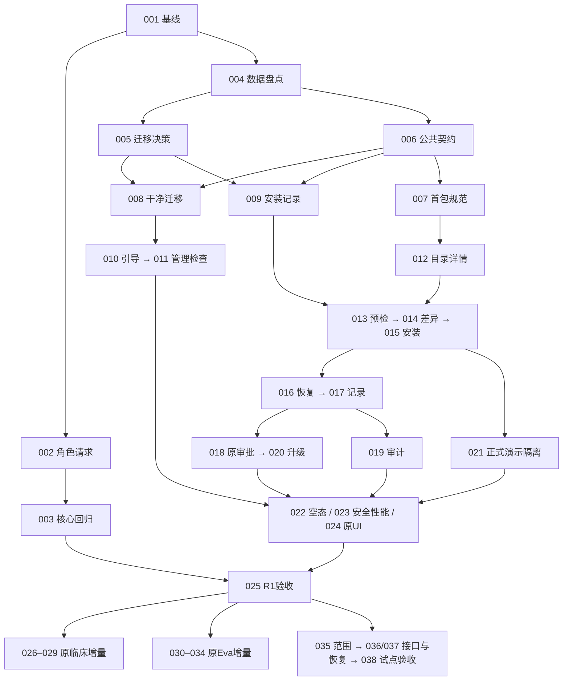

# HaoEMR 原系统增量开发计划

版本 1.0 · 2026-09-09 · **仅规划，尚未实施**。

本计划把 PRD v0.2 拆为 **43 项任务、129 条任务级验收标准**，覆盖全部 30 条功能需求。首期为 R0 稳定基线 + R1 干净安装与配置导入，共 25 项；R2、R3 按前置条件另行启动。5 项交付操作单独列账，不代表本轮授权提交、推送、迁库或部署。

## 文件入口

| 文件 | 用途 |
|---|---|
| [逐任务施工单](task-cards.md) | 每项含依赖、负责人、代码范围、实施动作、接口/数据影响、验收、风险、回滚及交接 |
| [任务与依赖表](task-dag.csv) | 可导入任务工具；稳定 ID、硬依赖、并行组、门禁、状态和需求引用 |
| [逐条验收矩阵](acceptance-matrix.csv) | 129 条 Given/When/Then；实际结果、执行人、版本、环境、证据列留空 |
| [需求追溯表](requirement-traceability.csv) | 原 ITER-FR / ITER-AC → 开发任务 → 任务级 ITER-TAC |
| [验收与发布手册](acceptance-and-release.md) | 通用完成定义、测试夹具、现有命令、阶段退出和外部操作边界 |
| [规划校验记录](planning-validation.json) | 任务编号、依赖、覆盖及“未实施”状态校验 |

## 不变约束

1. 保留 Spring Boot 模块化单体、PostgreSQL、JdbcClient/显式 SQL、Flyway、Vue 3 单入口、OpenAPI 生成、上下文租约、审计/Outbox。
2. 不改变原设计风格；当前四份 CSS 的导入顺序、原壳层、原管理组件和品牌继续使用。不把评审原型复制成新生产应用。
3. 主菜单仍为原 15 项，系统管理二级链接仍为原 13 项；名称、顺序、分组不变，新根路由目标 0。现有入口足够，本轮不启用备用新菜单。
4. 组织、参数、通用任务、模板、审计、能力包、临床与 Eva 优先复用。只有缺口盘点和契约决策确认不足，才增加最小安装记录/预检/恢复能力。
5. 本轮只新增本目录文档；不改生产代码、旧设计、迁移、配置或当前未提交变更，不执行生成器/应用测试/数据库操作。

依据：[PRD v0.2](../../../product/prd/2026-09-09-haoemr-next-iteration-prd.md)、[原系统融合修订](../../../design/ui-delivery/iteration-20260909/integration-revision.md)、[原交互规格](../../../design/ui-delivery/iteration-20260909/screens/specifications.md)、[09-06 安装计划](../2026-09-06-clean-install-and-module-data-pack-plan.md)。最新融合约束优先于早期计划中的独立设置页推导。

## 分期与退出结果

| 阶段 | 任务 | 用户可观察结果 | 退出条件 |
|---|---|---|---|
| R0 稳定基线 | 001–003，3 项 | 原角色/患者请求正确，核心写链可用 | 同候选门诊写链、住院审签和请求隔离有实际证据 |
| R1 可安装版本 | 004–025，22 项 | 空库引导→原组织配置→参数页导入→任务记录→原模板审批→空工作台 | 正式包和隔离升级两条全链通过，医院数据与历史受保护 |
| R2 医生效率与 AI | 026–034，9 项 | 原编辑器保存/质控完善，原 Eva 提供有依据的候选 | 医生任务可测；AI 独立评测及真实来源门禁另行满足 |
| R3 单院单科试点 | 035–038，4 项 | 指定范围真实连接、恢复和业务验收可核对 | 院方范围、实际回执、签名/存储与恢复实测齐备 |
| 交付操作 | 039–043，5 项 | 候选提交、推送、迁库、部署、观察分别可追溯 | 每一操作有对应授权和证据，不捆绑默许 |

R2 医生效率（026–029）和 AI（030–034）可分开交付；AI 接口/用例决策可与医生任务并行，但候选采用依赖可靠保存。R3 的基础试点不强制纳入 AI，选择纳入时必须增加 034 的发布条件。

## 执行批次与依赖

批次用于排队，不是按表号机械串行。CSV 的 depends_on 是硬依赖，parallel_group 是拓扑层级；同组还需检查共享文件、数据库和外部条件，不能直接据此同时写同一文件。

| 建议批次 | 任务 | 这一批解决什么 | 可并行与限制 |
|---|---|---|---|
| B0 基线 | 001 | 锁定源码、原有改动、真实 UI 和证据口径 | 首个任务，尚不修代码 |
| B1 复现与盘点 | 002–004 | 角色请求、历史临床失败、初始数据来源 | 004 可与 002 并行；003 依赖 002 |
| B2 设计门禁 | 005–007 | 新装/升级、安装/身份契约、首包规范与信任 | 005 与 006 可并行；007 依赖 006；外部正式来源只阻塞正式包放行 |
| B3 最小基础 | 008–011 | 干净迁移、安装来源记录、受控引导、原管理检查区 | 008 与 009 可并行；010→011 依赖引导链 |
| B4 原参数页导入 | 012–015 | 目录详情→预检→差异→原子安装 | 012 夹具与目录可先于安装写入；013 需 009；禁止只有后端就宣布交付 |
| B5 结果与领域联动 | 016–020 | 断线恢复、任务记录、原模板审批、审计、版本恢复 | 018 与 019 在 017 后可并行；020 依赖 018 |
| B6 交付收口 | 021–025 | 正式/演示隔离、空态、安全性能、样式、双路径验收 | 021 可在 015 后启动；023 与 024 按各自依赖运行；025 汇总放行 |
| B7 原临床增量 | 026–029 | 上下文→可靠保存→质控→医生试用 | 027/028 共享编辑器，按序实施 |
| B8 原 Eva 增量 | 030–034 | 用例决策→引用→候选采用→失败恢复→评测 | 030 可与 026 并行；032 依赖 027；无模型可做夹具验证，不做真实发布 |
| B9 试点 | 035–038 | 范围→真实接口/恢复→院方验收 | 036 与 037 可在 035 后并行；环境操作须授权 |
| B10 交付操作 | 039–043 | 本地提交→推送→目标迁库→部署→观察 | R1 本地候选无需等 R3；生产迁库与部署必须等试点和恢复条件 |

主要依赖图（完整逐项依赖以 CSV 为准）：

R1 最长依赖链（按任务节点数量计算，不是工期估算）：001→004→006→007→012→013→014→015→016→017→018→020→023→025。005/008/010 的迁移与引导链、003 核心回归也必须通过；它们可能成为实际排期关键路径。当前未提供人员、工时和实测复杂度，因此不承诺周数。

## 外部输入与启动规则

| 门禁 | 需要明确什么 | 阻塞范围 | 仍可推进 |
|---|---|---|---|
| G-MIG / 005 | 空库真实数据、迁移汇合、兼容恢复 | 008、009 的迁移实现 | 原代码盘点、UI 规格核对 |
| G-API / 006 | 引导身份、权限、契约、唯一性、事务和恢复 | 相应公共接口/Schema 实现 | 既有服务复用调查、原型规格 |
| G-PACK / 007 | 首包内容/许可、正式来源和信任配置 | 正式包交付、025 正式放行 | 合成夹具、解析器与异常测试 |
| G-USER / 029 | 医生、合成任务、测量口径 | 真实医生试用 | 026–028 功能实现与合成验收 |
| G-AI / 030 | 用例边界、模型/知识授权、费用预算、评测阈值 | 公共边界不明时阻塞实现；资源不足阻塞真实调用/发布 | 已冻结契约后的受控夹具测试 |
| G-PILOT / 035 | 首院科室、环境、范围、接口、责任人、RPO/RTO | 真实试点与正式部署 | R1 候选和隔离功能验收 |

来源未提供和代码尚未实现是不同状态。规划任务全部 PLANNED，不因现在没有外部输入就标记“开发失败”。未来执行中才能按事实登记受阻；任何门禁都不能靠时间经过或原型模拟通过。

## 已发现的规格收敛点

- 机构编码/名称长度需核对原组织服务校验，以现有契约为先；PRD 的建议长度不能直接覆盖原规则。组织导入已经存在，本轮保留，不再实现另一套导入。
- 首包准确内容、数量与限制由 007 固定。预览中的 3 份模板、性能场景的 30 条目、最大 500 条目属于不同样例/上限，不能混作同一验收数据。
- 包成功只代表草稿导入。结果提示可沿用原型“安装完成，待审批发布”，模板行为以现有 DRAFT→另一授权人审批发布为准，不据泛化“提交审核”文字新建阶段。
- `view=initialization`、`view=installations`、`source_install` 是设计建议，006 先核对原页面状态与路由契约，不能假定已经实现。
- 原静态原型和当前 Vue 样式存在覆盖差异；001/024 要对真实登录应用记录原 DOM/计算样式，不能用上一版静态设计测试替代生产 UI 验收。
- 新加的是安装能力，不是重建已有能力包组合/灰度发布服务。跨服务事务与失败证据能否同原约定兼容，006/009 必须回答。

## 首次实施交接包

后续用户明确要求开始开发时，建议先执行 **ITER-DEV-001**，再执行 **ITER-DEV-004** 的隔离盘点，001/004 本身不改业务代码。研发负责人用实际结果解锁 005/006，不直接从安装器编码开始。

给 `haonan-s008-coder` 的最小任务上下文：

> 执行 ITER-DEV-001，仅建立当前基线和真实证据口径。阅读 DEVELOPMENT_PRINCIPLES.md、PRD v0.2、integration-revision.md、本目录 task-cards.md 的 001 卡和 acceptance-and-release.md。记录已有未提交改动并保留，真实应用无法登录时记为受阻。不得执行迁移/恢复、生成代码、修改业务源文件、提交、推送或部署。交付基线清单和 001 的实际验收证据；未知项不要推测为通过。

每个后续批次交接只需共用依据 + 对应任务卡 + 硬依赖输出 + 相应 ITER-TAC 行 + 最新源码/环境标识。共用文件冲突、接口变化或发现新根因时先更新卡的范围和依赖，禁止顺手扩展重构。
